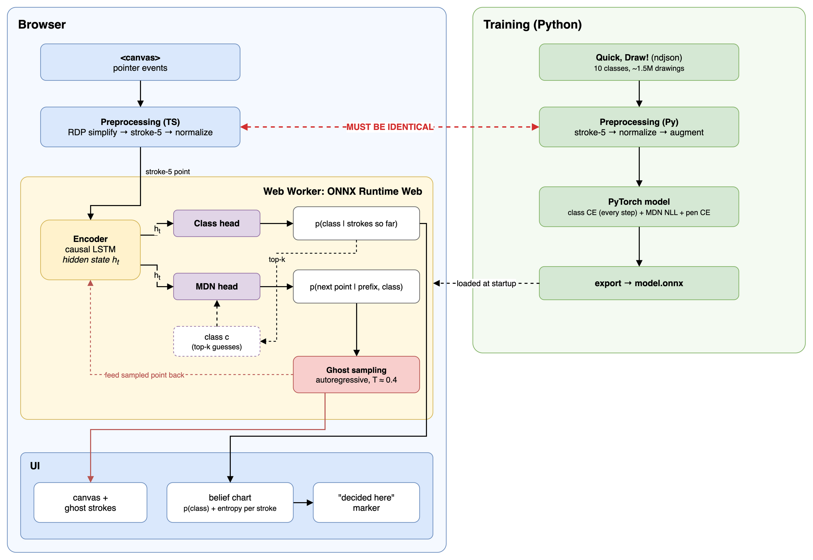

# sketch-ahead

## What it does

You draw on a canvas in the browser. After every stroke the app:

1. Guesses the class from the incomplete drawing.
2. Shows its belief over time: a live chart of class probabilities and uncertainty (entropy) per stroke, marks the stroke where it "made up its mind", and highlights which stroke made it change its guess.
3. Draws the rest for you: a faint ghost completion of the drawing for the top 1–2 guesses

Everything runs client-side in the browser, so no backend (yet?)

## What makes it different

This project aims to treat the drawing as a sequential state-estimation problem

- **Belief tracking:** The class distribution is treated as a posterior that is updated with each new stroke. The interesting output is the trajectory of the belief.
- **Future-state prediction:** The ghost completion is a prediction of where the sequence is going. The model is labelling the past and forecasting what comes next.
- **Measured earliness:** The main evaluation is how early the model is correct and stable, not just accuracy on finished drawings.

---

## Architecture

One causal sequence model with two heads, both computed in the same forward pass, point by point.



*Source: [`docs/architecture.drawio`](docs/architecture.drawio)*

### Data representation

- **Dataset:** Google's open [Quick, Draw! dataset](https://github.com/googlecreativelab/quickdraw-dataset), *simplified* ndjson (already RDP-simplified, stored as stroke sequences).
- **Classes:** start with 10–20, deliberately including classes that look alike early on (cat, dog, pig, lion, owl…) so the belief chart has something interesting to show.
- **Format:** stroke-5 per point: `(Δx, Δy, p_down, p_up, p_end)`.
- **Normalization (known pitfall):** the dataset scales each drawing by its *finished* bounding box, which is unknown during live drawing. Normalize by **canvas size** instead, and train with random scale/shift augmentation so the model is robust to how big and where people draw.

### Model

| Part | Choice | Reason |
|---|---|---|
| Encoder | 2-layer LSTM, 256–512 hidden | Causal by construction; hidden state is carried forward, so each new point costs O(1) in the browser |
| Class head | Linear → softmax at every timestep | Gives p(class \| prefix) for free so no manual prefix slicing needed |
| Generator head | Mixture Density Network: ~20 bivariate Gaussians for (Δx, Δy) + 3-way softmax for pen state | .. |
| Class conditioning | Class embedding fed into the generator head | Lets the app draw the ghost "as a cat" and "as a dog" side by side |

A small transformer is a possible later alternative. LSTM was chosen first because stateful inference and ONNX export are simpler.

### Training

- **Loss** = `CE(class)` at all timesteps + `MDN-NLL(next point)` + `CE(pen state)`.
- Classification loss at every timestep means the model is trained on all prefixes of every drawing automatically. 
- The generator gets the true class during training and the model's top-k guesses at inference.
- **Post-hoc calibration** with temperature scaling on a validation set.

### Belief layer

- After each stroke: log `p_t(class)` and entropy `H_t`, and plot both against stroke index.
- **Decision with hysteresis:** the app only "commits" to a class when `max p > τ` for `k` consecutive strokes
- **Stroke attribution:** `Δp_t = p_t(c) − p_{t−1}(c)`. The stroke with the largest jump toward the final class is highlighted on the canvas.
- **Design note:** the softmax output of a causal model already is the posterior given the prefix. No extra Bayesian update is applied on top, since that would count the evidence twice.

### Ghost completion

- On pointer-up, the current hidden state is sent to the worker, which samples ~50–150 points autoregressively (temperature ≈ 0.3–0.5).
- Sampled for the top 1–2 classes and rendered at low opacity in separate colors.
- Sampling is cancelled as soon as the user starts a new stroke.

### Frontend

- Vite + TypeScript, `<canvas>` with pointer events.
- ONNX Runtime Web inside a Web Worker. The model signature is `(point, h, c) → (class_logits, mdn_params, h', c')`.
- Preprocessing lives in one module, unit-tested against reference examples exported from the Python pipeline.

---

## Evaluation

| Metric | What it shows |
|---|---|
| **Accuracy vs. fraction of drawing completed** (10 %, 20 % … 100 %) | Main result: how early the model is right |
| **Earliest stable correct guess** | Average fraction of the drawing needed before the guess is correct and stays correct |
| **Calibration (ECE)** before/after temperature scaling | Whether the belief chart can be trusted |
| **Generator NLL** on test set + qualitative review | How plausible the ghost completions are |

---

## Process

1. **Data pipeline:** download, stroke-5 conversion, normalization, augmentation, with Python tests.
2. **Class head only:** train and check the accuracy-per-prefix curve.
3. **Generator head:** add MDN + class conditioning, and sample in a notebook.
4. **Browser app + belief panel:** ONNX export, canvas, worker, belief chart.
5. **Ghost completion:** autoregressive sampling in the worker, rendering on canvas.
6. **Polish:** calibration, evaluation figures, UI.

## Repository structure

```
sketch-ahead/
├── README.md
├── train/                  Python / PyTorch
│   ├── config.py           classes, max length, model sizes
│   ├── data/
│   │   ├── download.py     fetch Quick, Draw! ndjson into train/raw/ (gitignored)
│   │   ├── strokes.py      points ⇄ stroke-5, normalization, augmentation
│   │   └── dataset.py      PyTorch dataset with deterministic train/val/test split
│   ├── model.py            LSTM encoder, class head, MDN head, ghost sampling
│   ├── losses.py           class CE at every step + MDN NLL + pen CE
│   ├── evaluate.py         accuracy vs. fraction of drawing completed
│   ├── train.py
│   └── tests/
└── web/                    Vite + TypeScript (not scaffolded yet, see web/README.md)
```

Still to be written: `calibrate.py` (temperature scaling), `export_onnx.py`, and the web app.

## Getting started

```bash
cd train
pip install -r requirements.txt
python -m pytest                 # runs on synthetic data, no download needed
python -m data.download          # ~1–2 GB for the 10 default classes
python train.py --no-generator   # milestone 2: class head only
python train.py                  # both heads
```

## Tech stack

- **Training:** Python, PyTorch, NumPy
- **Export:** ONNX
- **Inference:** ONNX Runtime Web in a Web Worker
- **Frontend:** Vite, TypeScript, Canvas API

## Possible extensions

- **Few-shot custom classes:** draw something 5 times and the model learns to recognize it (embeddings / prototypical networks).
- **Bluff mode:** try to draw a cat that the model does *not* recognize until the very end.

## Credits

- Data: [Quick, Draw! dataset](https://github.com/googlecreativelab/quickdraw-dataset) by Google, CC BY 4.0.
- Generator approach inspired by Ha & Eck, *A Neural Representation of Sketch Drawings* (Sketch-RNN), 2017.
